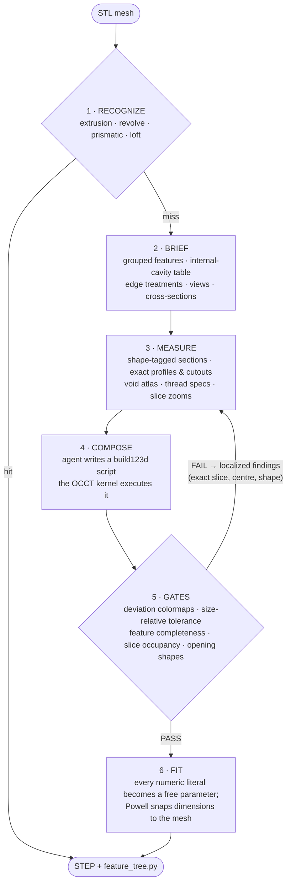

# stl2step

Turn an STL triangle mesh back into **editable CAD**: a build123d feature tree
plus a STEP file with real analytic surfaces — not re-skinned triangle soup.
An AI agent "draws" the part the way an engineer would (sketch → extrude →
revolve → hole → fillet), while deterministic tools do everything agents are bad
at: measuring, executing geometry, and refusing to accept a wrong answer.

## What it does

- **Input**: an STL (CAD-exported or scanned; watertight not required).
- **Output**: a STEP file + `feature_tree.py` — a runnable build123d script that
  *is* the editable feature recipe (open the STEP in Fusion/SolidWorks, or edit
  the tree and rebuild).
- **Contract**: the result is not accepted on looks. It must pass a stack of
  deterministic gates — dimensional, volumetric, per-feature, and per-opening —
  before it is called done.

Simple parts convert fully automatically. Complex parts are drawn by the agent
iterating against the gates.

## Quick start

Prerequisites: Python 3.10–3.14 and [Claude Code](https://claude.com/claude-code).

```bash
git clone https://github.com/nickpagz/stl2step.git && cd stl2step
./setup.sh
claude
```

`setup.sh` finds a suitable Python, creates the venv, installs the CAD stack,
and verifies the kernel imports — with clear instructions if anything is
missing. Then just ask:

> draw this stl: ~/Downloads/part.stl

The bundled skill (`.claude/skills/stl-draw`) loads automatically when Claude
Code runs in the repo and drives the whole loop — analysis, measurement,
composition, gates, refinement, export.

## How it works



The per-iteration judge is **geometric**, not visual: deviation colormaps and
slice overlays say *where* and *how much*, so every failure is a named, located
finding rather than "looks wrong". A matched-camera visual comparator exists as
a final structural check, but the gates that block acceptance are all
deterministic measurements.

## The gates

A candidate must clear **all** of these — each one exists because a real part
shipped wrong without it:

| Gate | Catches | Why the others miss it |
|---|---|---|
| Valid, closed solid | broken booleans, open shells | — |
| Deviation ≤ 0.1% of bbox diagonal (both directions) | dimensional error, scaled to the part | a fixed mm bar is too slack for small parts |
| Feature completeness | detected holes/bosses/fillets not modelled as *editable ops* | a missing fillet barely moves any distance metric |
| Slice occupancy (IoU on all 3 axes) | internal cavities filled solid, dropped pockets, oversize bodies | surface distance can't see whether *space* is solid |
| Per-loop opening shapes (scale-free) | a Ø4 hole modelled as a square (IoU 0.76), a trapezoid port as its bounding box (boundary check) | p99 quantiles and %-volume floors dilute with part size |
| Thread-band awareness | punishes neither: identified threads are modelled *nominal + spec*, and their bands are excluded from deviation/occupancy | a correct tap-drill hole "deviates" from the helix by design |

Failures are **localized**: the exact slice coordinate, the opening's centre and
both shapes (`CIRCLE Ø3.95 … modelled as rect 4.00 x 4.00`), the cavity band.
The agent fixes a named thing, never chases a number.

## Measure, don't guess

The core discipline (and most of the tooling) is that geometry flows
**mesh → model as code**, never through hand-transcription — every miss in
testing traced back to an agent re-drawing something from a lossy summary.

| Tool | Gives you |
|---|---|
| `probe bbox / sections / slice / point / profile` | extents, per-loop **shape tags** (`<CIRCLE Ø3.94>` / `<rect>` / `<profiled (~16 sides)>`), solid/void tests, radius profiles |
| `probe cutouts` | every wall opening as its **exact fitted profile** (lines + arcs), emitted as paste-ready `Mode.SUBTRACT` cuts with measured wall depth |
| `probe profile2d` | a cross-section fitted to facets + fillet arcs, emitted as a paste-ready extrude (rebuilds a 52-facet extrusion to 0.012 mm) |
| `probe voids` | the **internal cavities**, dimensioned: per-cavity span/Ø/volume/open-vs-sealed, cut snippets, and an internal-silhouette atlas |
| `probe thread` | thread identification: pitch, minor/major Ø, taper, closest ISO/UNC/UNF spec |
| `probe normals` | faceted-vs-curved verdict (a "curve" is usually flat facets + fillets) |
| `probe slicepics` / `compose slices` | dense section drawings / target-vs-model slice diffs across any band you suspect |

## Self-correction

The loop the agent runs (encoded in the bundled skill):

1. brief → read the features, cavity table, views, sections
2. measure anything you'd otherwise guess; paste extracted profiles as-is
3. compose `attempt.py` → `compose run` executes + gates it
4. every FAIL is a named, located finding → measure that exact spot → fix
5. when structure is right, `compose fit` snaps the numbers
6. final visual compare (matched-camera silhouette diff) as a structural sanity
   check

Threads are the one deliberate approximation: model the **nominal** hole/stud,
record the spec (`M10x1.5`, `1/2-20 UNF`) — real CAD convention — and declare
the band so the gates don't fight it.

## What you get

- `part.step` — the CAD file
- `feature_tree.py` — the editable recipe (runnable build123d script)
- `report.json` / `metrics.json` — the full gate verdict
- renders: deviation colormaps (missing/extra), slice-occupancy report,
  void atlas, matched-view comparison

There is also a headless CLI for the fully-automatic path (no agent):

```bash
PYTHONPATH=src ./.venv/bin/python -m stlstep.convert part.stl -o part.step --report out/
```

It prints `RESULT: PASS` (met tolerance), `RESULT: APPROX` (valid editable
model over tolerance — the report says exactly where it deviates, you decide),
or falls back to a watertight analytic-surface BREP (`--method solid`) that is
exact but not feature-editable.

## Results

Deterministic recognizers (no agent, seconds):

| Part | Route | Deviation |
|---|---|---|
| vslot (52-facet aluminium extrusion + bore) | extrude | 0.012 mm |
| shaft | revolve | 0.046 mm |
| open U-channel (thin-walled) | prismatic | 0.000 mm |
| square-to-round adapter + bore | loft | 0.089 mm |
| battery cover, bracket, multi-level plates | prismatic | PASS |

On a 4,400-part CAD corpus, roughly a third of parts convert deterministically
at < 0.1 mm. The rest route to the agent loop.

Agent-in-the-loop (real parts):

| Part | Result |
|---|---|
| Mold base plate (posts + rounded pins) | 0.018 mm PASS |
| SBC enclosure (vents, ports, HDMI cutout, standoffs) | 0.014 mm PASS |
| Corner bracket (thin curved-facet shell) | 4.0 mm faithful editable model (APPROX) |
| Threaded vortex tube (internal chamber, swirl vanes, threads) | dimensioned cavity map + thread specs; faithful interpretation, not sub-0.1 mm |

## Honesty about limits

- **Organic/freeform bodies** are out of scope for the feature path; the BREP
  fallback (`--method solid`) preserves them exactly but un-editably. Freeform
  *regions* inside mechanical parts still route to that fallback.
- **Threads are spec'd, not sculpted** — by design. Printable 3D threads would
  come from `bd_warehouse` on request.
- **Embossed text / surface reliefs** have no extractor yet.
- The gates are only as good as their recall: every field failure so far became
  a new detector plus a regression fixture, and the fixture suite is the
  contract that old failures stay fixed.

## Layout

```
src/stlstep/
  convert.py       CLI + escalation driver (recognize → compose → BREP)
  draw.py          deterministic recognizers + profile fitting + code emission
  compose.py       brief / run / fit / compare / slices  (the agent loop)
  probe.py         the measurement toolbox (read-only, allow-listable)
  featurecheck.py  the gate stack (tolerance, features, occupancy, loops)
  voids.py         internal-cavity analysis + atlas
  features.py      feature grouping, thread signature, section-loop holes
  segment_rg.py    region-growing segmentation
  topology.py …    BREP fallback (analytic faces + real intersection edges)
.claude/skills/stl-draw/   the agent skill (the loop, encoded)
tests/fixtures/            regression parts — one per fixed failure class
eval/run_corpus.py         corpus scoring harness
```

## License

[Apache 2.0](LICENSE)
